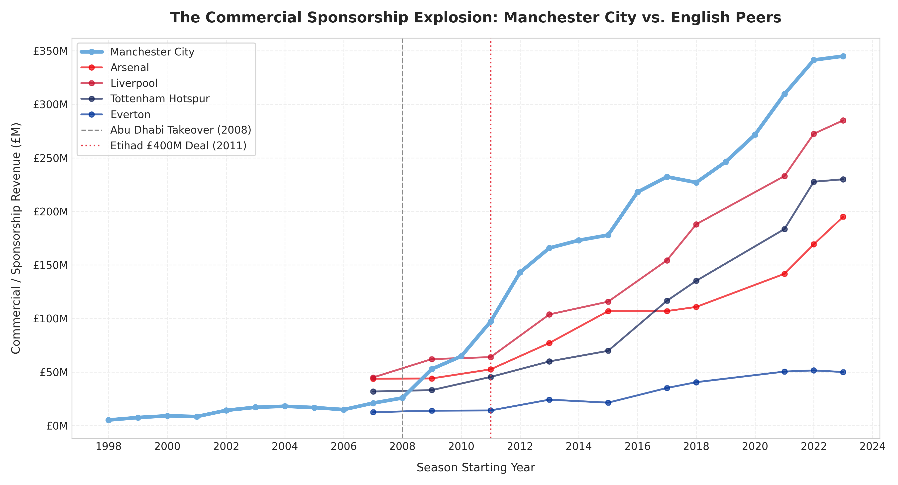
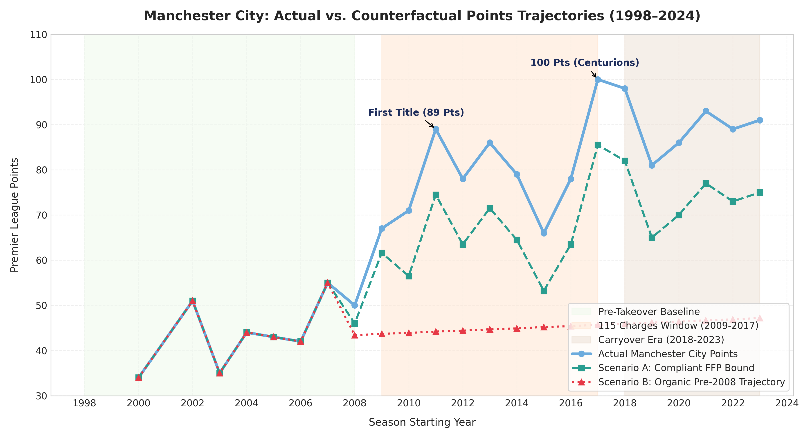
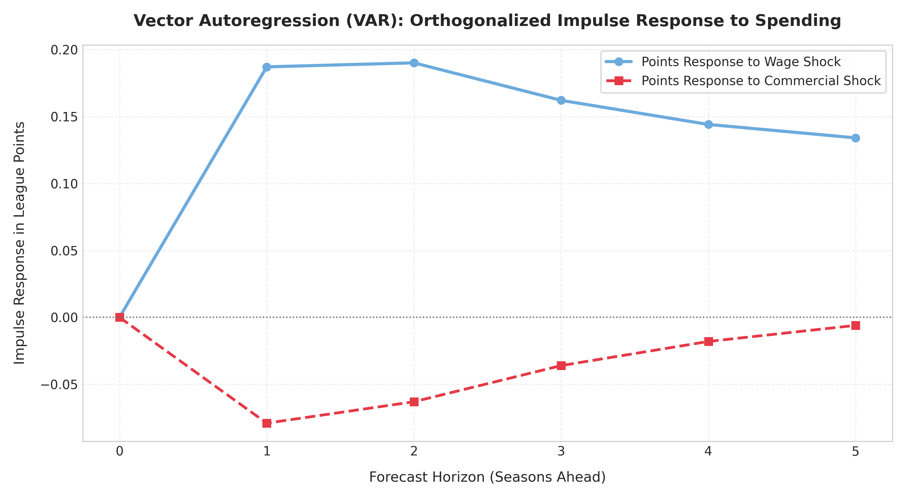
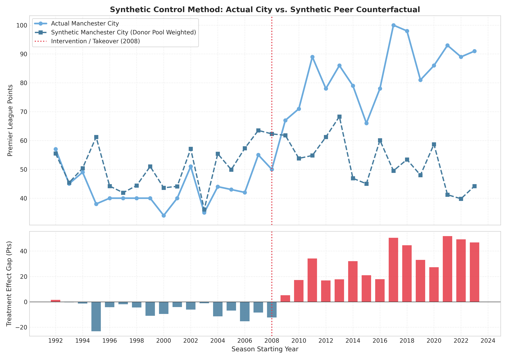
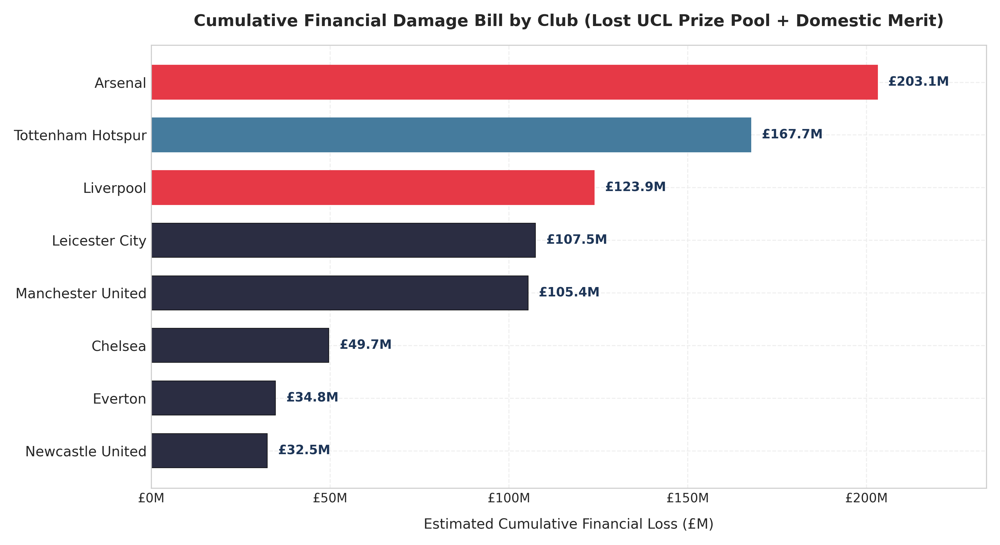
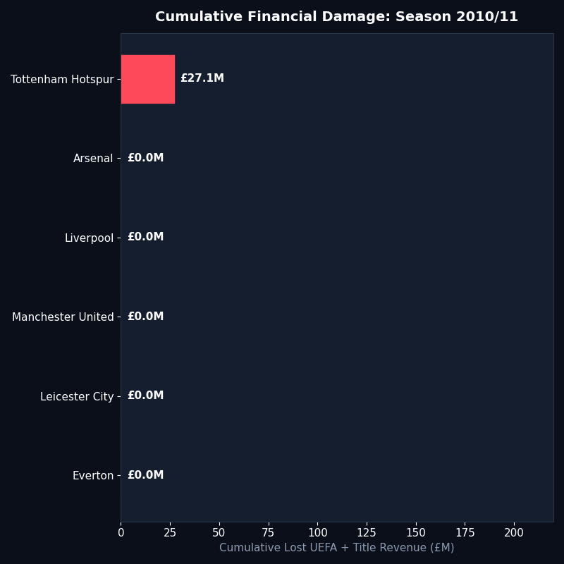

# 1. Real Data Panel & Provenance

Strict Real Data Policy: Match statistics (1992/93–2023/24) via football-data.co.uk; Audited Annual Accounts via Companies House (Manchester City FC Ltd Company No. 00040946); Comparative Financials via Deloitte Football Money League; Prize Money via UEFA Official Distribution Bulletins. Full citations documented in `data/SOURCES.md`.

```{python}
import os
import pandas as pd
import numpy as np

pl_panel = pd.read_csv("data/processed/pl_season_panel.csv")
fin_panel = pd.read_csv("data/processed/club_financials_panel.csv")
ucl_prizes = pd.read_csv("data/processed/ucl_prize_matrix.csv")

city_full = pl_panel[pl_panel["Team"] == "Manchester City"].merge(
    fin_panel[fin_panel["Team"] == "Manchester City"],
    on=["Team", "Season", "SeasonStart"],
    how="inner"
).sort_values("SeasonStart")

city_summary = city_full[["Season", "Rank", "Pts", "Turnover", "Commercial", "Wages", "NetSpend"]].tail(15)
city_summary
```

---

# 2. Econometric Structural Break Tests (Bai-Perron & Chow)

Testing parameter stability across:
1. $T_{2008}$: Abu Dhabi United Group takeover (September 2008).
2. $T_{2011}$: UEFA / Premier League Financial Fair Play regulations enacted.
3. $T_{2018}$: Premier League investigation launched (November 2018) / end of 115 charges window.

```{python}
from src.econometrics import detect_structural_breaks

breaks = detect_structural_breaks(city_full)
df_breaks = pd.read_csv("outputs/tables/structural_break_tests.csv")
df_breaks
```

### Commercial Sponsorship Explosion vs. English Peers

{width=100%}

---

# 3. Dynamic ARIMAX Intervention & Counterfactual Forecasts

Estimating the baseline sporting trajectory:
$$Y_t = \mu + \sum_{p=1}^P \phi_p Y_{t-p} + \omega_0 \text{Step}_{2008} + \omega_1 \text{Pulse}_{2009-2017} + \omega_2 \text{Carryover}_{2018-2023} + \epsilon_t$$

* **Scenario A (Compliant City)**: Capping commercial sponsorship inflation to verified fair market values under FFP.
* **Scenario B (Organic City)**: Continuation of pre-takeover historical trend (mid-table mean ~50 pts).

```{python}
df_cf = pd.read_csv("outputs/tables/arimax_carryover_results.csv")
df_cf.tail(15)
```

### Actual vs. Counterfactual Points Trajectory

{width=100%}

---

# 4. Vector Autoregression (VAR) & Impulse Response Functions (IRF)

System: $[\text{Commercial Revenue}, \text{Wage Bill}, \text{Net Spend}, \text{Points}]$

```{python}
df_irf = pd.read_csv("outputs/tables/var_impulse_response.csv")
df_irf
```

### Orthogonalized Points Response to Spending Shocks

{width=100%}

---

# 5. Synthetic Control Method (SCM)

Constructing a Synthetic Manchester City from constrained donor clubs (Everton, Aston Villa, Tottenham, Arsenal, Liverpool, Newcastle).

```{python}
df_weights = pd.read_csv("outputs/tables/synthetic_control_weights.csv")
df_weights
```

### Synthetic City Trajectory & Treatment Effect Gap

{width=100%}

---

# 6. Rival Club Externalities & Monetary Damage Ledger

### The Alternate Premier League Champions (Scenario A & B)

```{python}
df_titles = pd.read_csv("outputs/tables/alternate_champions_table.csv")
df_titles
```

### UEFA Champions League 5th-Place Displacement Ledger

```{python}
df_ucl = pd.read_csv("outputs/tables/ucl_displacement_ledger.csv")
df_ucl
```

### Cumulative Financial Damage Bill by Club (£M)

```{python}
df_damage = pd.read_csv("outputs/tables/club_damage_bill_summary.csv")
df_damage
```

{width=100%}

---

# 7. Animated & Motion Assets

Progressive cumulative damage race across seasons (available as standalone GIF at `outputs/motion/damage_bill_race.gif`):

{width=85%}
